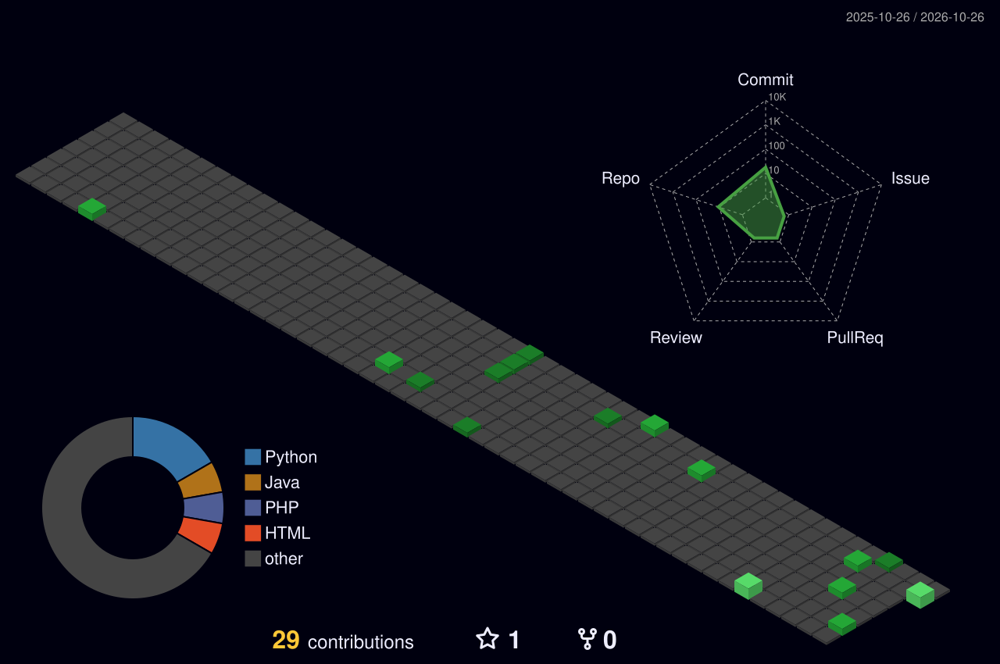

<h1 align="center">Hi, I'm Mahmoud Abdallah 👋</h1>

  🎓 Computer Science Student at Helwan University, Cairo, Egypt

  🔐 Cybersecurity | Penetration Testing | Bug Bounty Hunting

---

### 🚀 About Me

- 🕵️ Penetration Tester | Bug Hunter
- 📚 Always learning new technologies and improving my security & development skills
- 💻 I also enjoy building clean front-end interfaces
- 🌍 Based in Cairo, Egypt

---

### 🛠️ Tech Stack & Tools

**Languages & Web:**

`HTML` `CSS` `JavaScript` `PHP` `Python` `Java` `MySQL`

**Security Tools:**

`Burp Suite` `Wireshark` `Nmap` `Metasploit` `Kali Linux` `Hydra` `FFUF` `OWASP ZAP` `Nessus`

---

### 📊 GitHub Analytics

  

---

### 💻 Most Used Languages

  

---

### 📈 GitHub Activity Graph

  

---

### 📌 Featured Projects

- **Golden Store** — Frontend project developed by a first-year college team
- **Penetration Testing Report** — Full pentest report on VulnBlog Web Application (NTI final project)
- **Project Management System** — Desktop app built with Java Swing
- **Smart City Infrastructure Network** — Network design using Cisco Packet Tracer

---

### 🏆 Certificates & Achievements

- Network Security – NTI Summer Training
- eJPTv2 – Red Nexus Academy (Hossam Shady)
- Cyber Security Fundamentals – Sprints
- Cyber Security Engineer Job Profile Course – Mahara-Tech
- CyberOps Associate – Cisco Networking Academy

---

### 📫 Let's Connect

  <a href="https://www.linkedin.com/in/M7moudAbdallah01/">LinkedIn</a> •
  <a href="https://github.com/M7moudAbdallah01">GitHub</a> •
  <a href="mailto:mahmoud.a.sharafelden@gmail.com">Email</a> •
  <a href="https://mahmoud-sharaf.freehosting.dev/">Portfolio</a>

---

  ⭐ Feel free to explore my repositories and reach out for collaboration!

