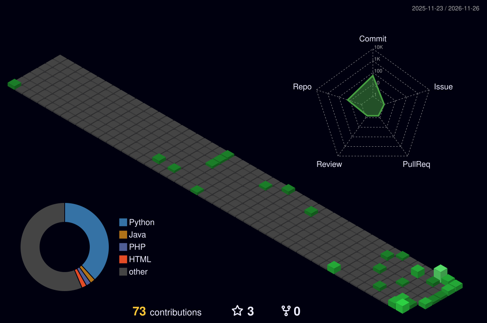

## <b>السَّلاَمُ عَلَيْكُمْ وَرَحْمَةُ اللهِ وَبَرَكَاتُهُ ✨</b>

---

## 🚀 About Me

Computer Science student at **Helwan University** with a strong focus on **offensive security**. I enjoy finding and responsibly reporting vulnerabilities in web applications and networks, and I also like building clean front-end interfaces.

- 🎓 Computer Science, **Helwan University** — Cairo, Egypt
- 🕵️ Penetration Testing, Web Application Security, Bug Bounty
- 🏅 Certified: **eJPTv2**, **Cisco CyberOps Associate**
- 📚 Continuously learning new attack techniques and defensive practices

---

## 🛠️ Tech Stack & Tools

**Languages & Web**
 

**Operating Systems & Tools**
 

**Security Tools**
 

---

## 📌 Featured Projects

<!-- TODO: replace each "#" with the real repository / report link -->

### 🔐 Security
- **[Penetration Testing Report — VulnBlog](#)** — Full penetration test of the VulnBlog web application (NTI final project)
- **[Smart City Infrastructure Network](#)** — Network design and simulation using Cisco Packet Tracer

### 💻 Development
- **[Golden Store](#)** — Front-end e-commerce project built with a first-year college team
- **[Project Management System](#)** — Desktop application built with Java Swing

---

## 🏆 Certificates & Achievements

| Certificate | Issuer |
|---|---|
| eJPTv2 (Junior Penetration Tester) | Red Nexus Academy — training for the INE eJPT exam |
| CyberOps Associate | Cisco Networking Academy |
| Network Security | NTI — Summer Training |
| Cyber Security Fundamentals | Sprints |
| Cyber Security Engineer Job Profile | Mahara-Tech |

---

## 📊 GitHub Stats

 

<!--
Optional: 3D contribution graph.
It only works after you set up the "profile-3d-contrib" GitHub Action in your
profile repo, which generates the SVG file. Otherwise the image will be broken.

-->

---

### 📈 GitHub Activity Graph

  

---

### 🤝 Let's Connect

⭐ Feel free to explore my repositories and reach out for collaboration!

